# Software Requirements Specification
## NG Yoga Studio — Membership and Programme Routing System

**Version:** 1.0
**Date:** 23 October 2026
**Studio:** NG Yoga Studio, Ashok Nagar, Indore
**Classification:** Hackathon Prototype with Production-Grade Scalable Design

---

## Table of Contents

1. [Introduction](#1-introduction)
2. [Overall Description](#2-overall-description)
3. [Stakeholders and User Roles](#3-stakeholders-and-user-roles)
4. [Functional Requirements](#4-functional-requirements)
5. [Non-Functional Requirements](#5-non-functional-requirements)
6. [Business and Routing Rules](#6-business-and-routing-rules)
7. [UML Diagrams](#7-uml-diagrams)
8. [Tech Stack](#8-tech-stack)
9. [System Architecture](#9-system-architecture)
10. [Database Schema](#10-database-schema)
11. [API Specification](#11-api-specification)
12. [Application Layer Design](#12-application-layer-design)
13. [Scalability Strategy](#13-scalability-strategy)
14. [Implementation Plan](#14-implementation-plan)
15. [Legal and Ethical Constraints](#15-legal-and-ethical-constraints)
16. [Glossary](#16-glossary)
17. [Crisis Adaptation: Countering The Great Compression](#17-crisis-adaptation-countering-the-great-compression)

---

## 1. Introduction

### 1.1 Purpose

This document defines the complete software requirements for the NG Yoga Studio Membership and Programme Routing System. It is written to serve two audiences simultaneously: the hackathon evaluation panel, who need to understand scope and implementation; and the development team, who need precise specifications to build a working prototype that is structurally ready for production scaling.

### 1.2 Scope

The system replaces three manual processes at NG Yoga Studio:

| Manual Process | Digital Replacement |
|----------------|---------------------|
| Verbal health screening, or none | Health intake form with rule-driven routing engine |
| Phone-based batch booking (can overfill) | Real-time capacity-enforced digital booking |
| Spreadsheet membership and attendance tracking | Persistent database with automated expiry and inactivity detection |

The system covers three delivery levels:

- **Level 1 (Core):** Health intake, routing, batch booking, membership plans, check-in, persistent storage.
- **Level 2 (Retention):** Expiring member alerts, inactive member alerts, WhatsApp message generation, trial-to-conversion report.
- **Level 3 (Stretch):** Waitlist with automatic promotion on cancellation.
- **Crisis Adaptation (TechSprint Response):** Multi-signal retention triage (expiry, inactivity, unconverted trials), contextual WhatsApp re-engagement templates countering ₹299 AI apps, and member-facing human-led safety differentiators protecting studio jobs and member health.

### 1.3 Design Philosophy: Small Now, Scales Later

Every architectural decision follows one principle: build the minimum that works today without creating structural debt that blocks scaling tomorrow. Concretely this means:

- The database schema includes `tenant_id` columns on tables that will need multi-studio isolation, even though a single `tenant_id` value is used in Phase 1.
- The routing engine is a pure function with zero framework dependencies, so it can run on client, server, edge function, or mobile app without modification.
- The repository pattern separates database queries from business logic, making the database engine swappable.
- The API is designed as REST from day one, ready to be extracted into independent microservices.

### 1.4 Definitions

| Term | Meaning |
|------|---------|
| Member | A person registered with the studio |
| Batch | A scheduled class session (morning or evening) for a specific programme on a specific date |
| Trial | A single free class available to first-time visitors per phone number |
| Check-in | Recording a member's physical attendance at a batch |
| Routing | The deterministic rule-based logic that maps health conditions and goals to programme recommendations and restrictions |
| Waitlist | An ordered queue of members waiting for a seat in a full batch |
| Tenant | A studio instance (single value in MVP; multiple in SaaS phase) |
| RLS | Row Level Security — PostgreSQL policy system for per-row access control |
| Repository | A data access class that encapsulates all queries for one domain entity |

---

## 2. Overall Description

### 2.1 Product Functions

| Module | Primary Function |
|--------|-----------------|
| Health Intake and Routing | Collect member health data; apply R1 to R6 rules; return recommendation and restrictions |
| Batch Booking | Show real-time seat availability; enforce capacity (B1) and trial uniqueness (B2) |
| Membership Management | Accept plan selection; calculate expiry (B3); display status |
| Check-in System | Look up member by phone; enforce expiry rule (B4); record attendance |
| Retention Dashboard | Surface members expiring within 7 days; surface members inactive for 7 or more days |
| WhatsApp Generator | Build pre-filled `wa.me` deep-links for renewal and inactivity follow-ups |
| Analytics | Report trial count, converted count, conversion rate |
| Waitlist | Queue members when batch is full; auto-promote on cancellation |

### 2.2 Operating Environment

| Layer | Technology | Region / Config |
|-------|-----------|-----------------|
| Browser runtime | Chrome 115+, Safari 17+, Firefox 118+, Edge 115+ | Desktop and mobile |
| Minimum mobile viewport | 375 x 667 px (iPhone SE) | Responsive |
| Server runtime | Node.js 20 (Vercel Serverless Functions) | Global edge |
| Database | PostgreSQL 15 via Supabase | AWS ap-south-1 (Mumbai) |
| Transport | HTTPS only, TLS 1.2 minimum | — |

### 2.3 Constraints

- The application must not provide medical diagnoses or clinical advice. Routing is based solely on studio-defined safety rules.
- Only sample and self-created data may be used during the hackathon. No real member health data.
- The `wa.me` deep-link approach is used for WhatsApp in the prototype. No WhatsApp Business API credentials are required.
- Any team member must be able to explain any piece of the routing and booking logic.

---

## 3. Stakeholders and User Roles

### 3.1 Role Definitions and Access Matrix

| Role | Pages Accessible | Capabilities |
|------|-----------------|--------------|
| New Member (unauthenticated) | `/join`, `/batches`, `/membership` | Submit health form, receive routing result, book batch, purchase membership |
| Front Desk Staff (authenticated) | All member pages + `/staff/checkin`, `/staff/batches` | All member actions + search member by phone, approve or deny check-in, view batch capacity |
| Studio Owner (authenticated, elevated role) | All staff pages + `/owner/dashboard`, `/owner/analytics` | All staff actions + view expiring and inactive member lists, generate WhatsApp links, view conversion report, manage batch schedules |
| Scheduler (system actor) | None (internal) | Mark expired memberships; evaluate inactivity; trigger waitlist promotion |

### 3.2 Business Value by Role

| Stakeholder | Pain Points Solved | Measurable Outcome |
|-------------|-------------------|-------------------|
| New Member | Lands in wrong class without health check | Zero unsafe class placements |
| Front Desk | Batch overfills via phone; repeated free trials | No capacity violations; no duplicate trials |
| Studio Owner | Missed renewals; no view of inactive members | Churn detected 7 days early; higher renewal rate |

---

## 4. Functional Requirements

### 4.1 Health Intake and Programme Routing (Level 1)

**FR-1.1 — Intake Form Fields**

The system shall collect all of the following from a prospective member before any booking is possible:

| Field | Type | Validation |
|-------|------|------------|
| Full Name | Text | Required, minimum 2 characters |
| Mobile Number | Text | Required, matches `/^[6-9]\d{9}$/`, unique per member |
| Age | Integer | Required, 10 to 80 inclusive |
| Experience Level | Enum | Required: Beginner, Intermediate, or Advanced |
| Main Goal | Enum | Required: Weight Loss, Flexibility, Stress Relief, General Fitness |
| Health Conditions | Multi-select | At least one required: Back Pain, Knee Pain, High Blood Pressure, PCOD/PCOS, Pregnancy, None of the above |
| Consent Statement | Checkbox | Required: "I agree to share this information with NG Yoga Studio staff for class placement purposes." |

**FR-1.2 — Routing Result Display**

After form submission, the system shall display:
- The recommended programme, visually highlighted.
- All allowed programmes as selectable cards.
- All blocked programmes rendered as disabled cards with a tooltip explaining the blocking rule.
- If R1 (pregnancy) applies: no programme cards are shown; only the message "Please speak to an instructor before joining."
- The disclaimer on the same page: "This is not medical advice. Consult a qualified health professional for medical concerns."

**FR-1.3 — Duplicate Member Handling**

If a phone number already exists in the database, the system shall update the health profile for that member and return the existing `member_id` rather than creating a duplicate record.

---

### 4.2 Batch Booking (Level 1)

**FR-2.1 — Batch Listing**

The system shall display a list of available batches. Each batch card shall show: programme name, time slot (Morning or Evening), date, current seats remaining, and a booking button or a disabled state.

**FR-2.2 — Seat Availability (Real-Time)**

Seat counts shall update in real time across all connected clients when any booking or cancellation occurs, without requiring a page refresh.

**FR-2.3 — Booking Creation Rules**

A booking shall be created only when all of the following conditions pass in sequence:

1. The chosen programme is not in the member's blocked list from the routing engine.
2. The batch `booked_count` is strictly less than `capacity` (B1).
3. If `booking_type` is `trial`: no prior booking exists for this phone number with `booking_type = 'trial'` (B2).
4. If `booking_type` is `member`: the member has an active membership.

All conditions are evaluated within a single database transaction with a row-level lock on the batch row to prevent race conditions.

**FR-2.4 — Error Responses**

| Failure Case | HTTP Status | Client Message |
|-------------|-------------|----------------|
| Programme blocked by routing rule | 403 | "This programme is not recommended for your health profile. Please choose an available option." |
| Batch at capacity | 409 | "This batch is full. You can join the waitlist." |
| Free trial already used | 409 | "You have already used your free trial. Please purchase a membership to continue." |
| Member has no active membership (member booking) | 403 | "Your membership has expired. Please renew to book." |

---

### 4.3 Membership Management (Level 1)

**FR-3.1 — Plan Options (B3)**

| Plan | Duration (days) | Price (INR) |
|------|-----------------|-------------|
| 1 Month | 30 | 1,500 |
| 3 Months | 90 | 4,000 |
| 6 Months | 180 | 7,500 |

**FR-3.2 — Membership Record**

On plan selection, the system shall:
1. Set `start_date` to the current date.
2. Compute `expiry_date` as `start_date + plan_duration_in_days`.
3. Insert a membership record with `status = 'active'`.
4. Display a membership card showing plan name, price, start date, expiry date, and status badge.

**FR-3.3 — Status Badge Logic**

| Condition | Badge |
|-----------|-------|
| `expiry_date > TODAY + 7` | Active |
| `expiry_date` within next 7 days | Expiring Soon |
| `expiry_date < TODAY` | Expired |

---

### 4.4 Check-In System (Level 1)

**FR-4.1 — Phone Lookup**

Staff shall enter a 10-digit phone number. The system shall return: member name, most recent membership status, expiry date, assigned programme, and date of last check-in.

**FR-4.2 — Check-In Decision (B4)**

| Membership Condition | Action | Display |
|----------------------|--------|---------|
| `status = 'active'` AND `expiry_date >= TODAY` | Allow; insert into `checkins` | Green card: member name, expiry date |
| `status = 'expired'` OR `expiry_date < TODAY` | Deny | Red card: "Membership expired. Please renew to continue." with Renew Now button |
| Phone not found | Deny | Neutral card: "Member not found. Please ask them to register." |

---

### 4.5 Member Retention Dashboard (Level 2)

**FR-5.1 — Expiring Memberships**

The dashboard shall query and display all members where `expiry_date` is between today and today plus 7 days, with columns: Name, Phone, Plan, Expiry Date, Days Remaining, Action.

**FR-5.2 — Inactive Members**

The dashboard shall display all members with an active membership whose most recent `checkin_time` is more than 7 days ago, or who have never checked in. Columns: Name, Phone, Plan, Last Check-in, Days Inactive, Action.

**FR-5.3 — WhatsApp Message Generation**

Each row in both alert lists shall have a "Send WhatsApp" button. Clicking it shall open WhatsApp with the member's phone number pre-filled and the appropriate template message encoded in the URL.

Renewal template:
```
Hi [Name], your NG Yoga Studio membership expires on [Date].
Renew now to keep your spot.
Contact us at NG Yoga Studio, Ashok Nagar, Indore.
```

Inactivity template:
```
Hi [Name], we have not seen you at NG Yoga Studio for [X] days.
We hope you are well. Come back and continue your wellness journey.
Contact us at NG Yoga Studio, Ashok Nagar, Indore.
```

URL format: `https://wa.me/91{phone}?text={url_encoded_message}`

**FR-5.4 — Trial Conversion Report**

The system shall display:
- Total free trials taken.
- Total members who converted from trial to a paid membership.
- Conversion rate as a percentage.

---

### 4.6 Waitlist (Level 3)

**FR-6.1 — Join Waitlist**

When a batch is full, the booking button shall change to "Join Waitlist." Clicking it shall insert a record into the `waitlist` table with an auto-assigned position and return a confirmation message with the position number.

**FR-6.2 — Auto-Promotion on Cancellation**

When any confirmed booking is cancelled:
1. The system shall decrement `booked_count` on the batch.
2. The system shall query the waitlist for the earliest entry (lowest position, `notified = false`) for that batch.
3. If found: create a confirmed booking for that member, increment `booked_count`, mark `waitlist.notified = true`.
4. Return the promoted member's name and a WhatsApp link to the staff interface so the staff can notify the member.

All steps within a single transaction.

---

## 5. Non-Functional Requirements

### 5.1 Performance Targets

| Operation | Target |
|-----------|--------|
| Page initial load (4G mobile) | Under 2 seconds |
| Booking confirmation | Under 1 second after submit |
| Phone number check-in lookup | Under 500 milliseconds |
| Dashboard data load | Under 3 seconds |
| Real-time seat count propagation | Under 500 milliseconds |

### 5.2 Security

- All client-server communication over HTTPS with TLS 1.2 minimum.
- Supabase Row Level Security policies enforce that staff pages cannot be accessed by unauthenticated users.
- Server-side Zod validation on every API route, independent of client-side validation.
- Booking capacity check uses a row-level lock (`SELECT ... FOR UPDATE`) within a transaction to prevent concurrent overbooking.
- Phone numbers are not encrypted at rest (not a medical application) but are masked to `XXXXXX####` format in non-owner UI contexts.

### 5.3 Reliability

- Supabase SLA: 99.9 percent uptime.
- Vercel SLA: 99.99 percent uptime.
- All member and booking data persists server-side. No reliance on `localStorage` or `sessionStorage` for primary data.

### 5.4 Usability

- Mobile-first responsive design, minimum viewport 375 pixels wide.
- Minimum touch target size 44 x 44 pixels.
- Inline validation errors on all form fields.
- No primary user action requires more than 3 clicks from page load.
- The medical disclaimer is visible on every page where health data is displayed or collected.

### 5.5 Scalability Design Constraints

- All API routes are stateless. Horizontal scaling requires no session affinity.
- The `tenant_id` column is present on `members`, `batches`, and `bookings` tables. It holds a single constant value in Phase 1 but provides the multi-tenant isolation hook for Phase 2 without a schema migration.
- The routing engine (`lib/routing.ts`) has no framework imports and no I/O. It can be moved to an edge function, a mobile bundle, or a separate microservice without modification.
- The repository layer (`lib/db/*.ts`) is the only layer that imports the database client. Swapping the database requires changes only in these files.

---

## 6. Business and Routing Rules

### 6.1 Routing Rules (R1 to R6)

Conditions take absolute priority over goals. Rules are evaluated in the order listed.

| ID | Trigger | Effect |
|----|---------|--------|
| R1 | `conditions` contains `pregnancy` | Hard block. No booking allowed. Message: "Please speak to an instructor before joining." |
| R2 | `conditions` contains `back_pain` or `knee_pain` | Block `Power` and `Advanced`. Recommend `Yoga Therapy`. |
| R3 | `conditions` contains `high_bp` | Block `Power` and `Advanced`. Recommend `Traditional` or `Iyengar` if no prior recommendation set. |
| R4 | `conditions` contains `pcod` | Recommend `PCOD` programme. No additional blocks. |
| R5 | `conditions` equals `none` AND `goal` equals `weight_loss` | Recommend `Weight Loss` programme. Applies only when no conditions are present. |
| R6 | `experience_level` equals `beginner` | Block `Advanced`. Always applied regardless of conditions. |

### 6.2 Rule Evaluation Priority

```
R1 evaluated first  (hard block — exits immediately if triggered)
R2 evaluated second (adds to blocked set, sets recommended)
R3 evaluated third  (adds to blocked set, conditionally sets recommended)
R4 evaluated fourth (overrides recommended if pcod present)
R5 evaluated fifth  (only if conditions = none; sets recommended)
R6 evaluated always (adds Advanced to blocked for beginners)
```

### 6.3 Booking and Membership Rules (B1 to B4)

| ID | Rule |
|----|------|
| B1 | A batch cannot be booked when `booked_count >= capacity`. |
| B2 | A `trial` booking type is permitted only once per unique phone number across all time. |
| B3 | Plans and prices: 1 month = INR 1,500; 3 months = INR 4,000; 6 months = INR 7,500. Expiry equals start date plus plan duration in days. |
| B4 | Check-in is denied when membership `expiry_date` is earlier than the current date. Message: "Membership expired. Please renew to continue." |

---

## 7. UML Diagrams

All diagrams below were authored in Graphviz DOT language and rendered with Graphviz 16.1.0. The `.dot` source files are stored alongside the SRS at `docs/diagrams/`.

---

### 7.1 Use Case Diagram

Shows all actors (New Member, Front Desk, Studio Owner, System) and their use cases, including include and extend relationships.

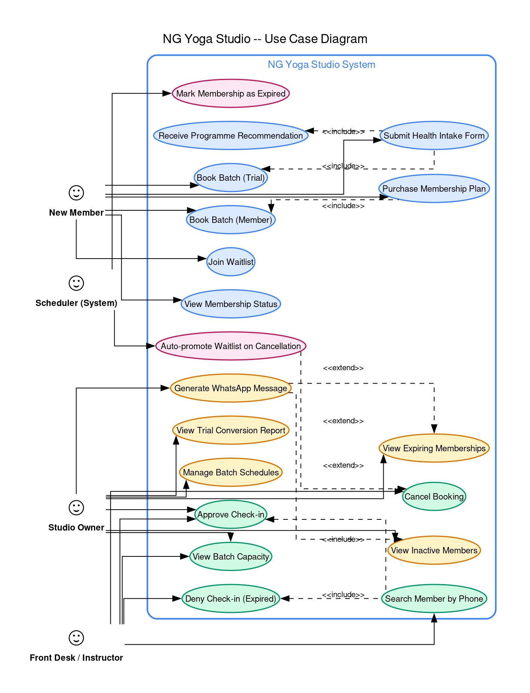

**DOT Source:** `docs/diagrams/01_use_case.dot`

---

### 7.2 Domain Class Diagram

Shows all domain entities with attributes, typed methods, enumerations, and relationships (associations, compositions, dependencies). Includes the `RoutingEngine` service class and all enumerations as separate nodes.

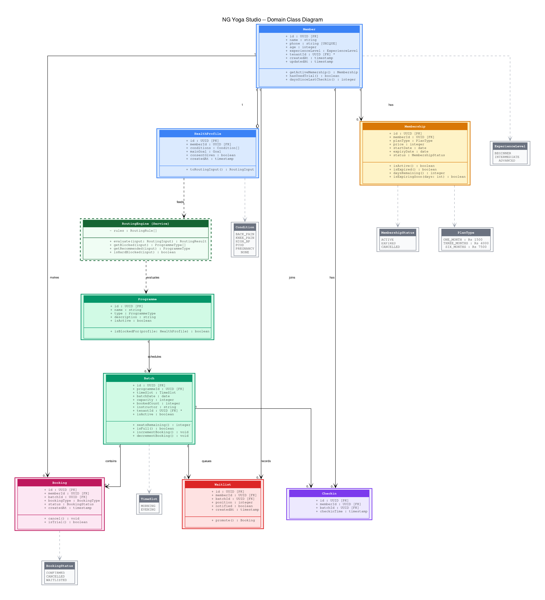

**DOT Source:** `docs/diagrams/02_class_diagram.dot`

---

### 7.3 Entity Relationship Diagram

Shows all eight database tables (including the future `tenants` table as a dashed node) with full column lists (name, type, constraints), primary keys, foreign keys, unique keys, and cardinality labels on all relationships.

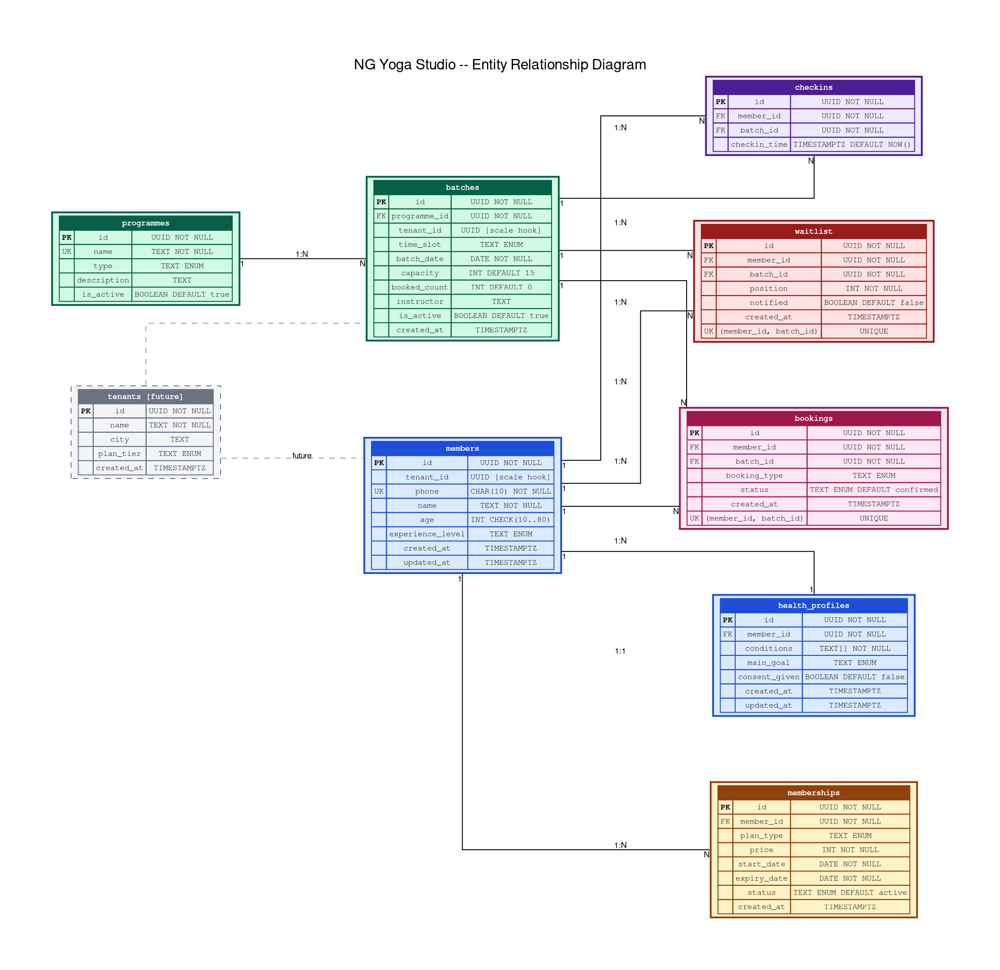

**DOT Source:** `docs/diagrams/03_er_diagram.dot`

---

### 7.4 Sequence Diagram — Member Onboarding

Shows the complete message flow from member filling the form, through client-side and server-side Zod validation, database uniqueness check, member and health profile insertion, routing engine evaluation, and final programme recommendation display.

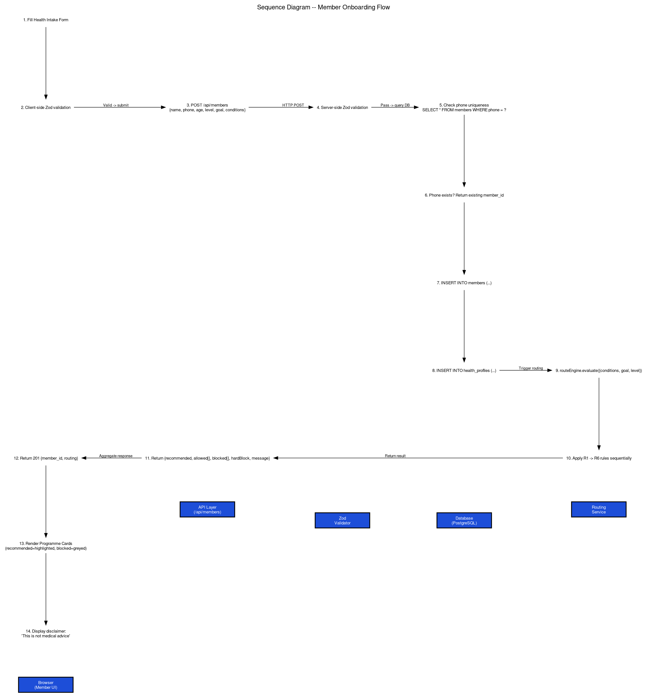

**DOT Source:** `docs/diagrams/04_seq_onboarding.dot`

---

### 7.5 Sequence Diagram — Batch Booking (Concurrency-Safe)

Shows the full booking flow including routing validation, the database transaction with row-level lock, capacity check (B1), trial uniqueness check (B2), all three rejection paths with correct HTTP codes, successful booking commit, Supabase Realtime broadcast, and client seat-count update.

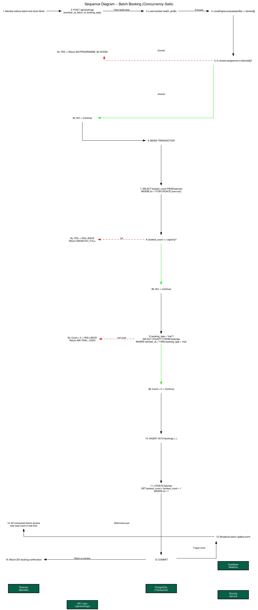

**DOT Source:** `docs/diagrams/05_seq_booking.dot`

---

### 7.6 Sequence Diagram — Staff Check-In

Shows phone number lookup, member-found and member-not-found branches, expiry date evaluation (B4), approved check-in insertion into `checkins`, and the two UI outcomes (green confirmation card vs red denial card with Renew Now CTA).

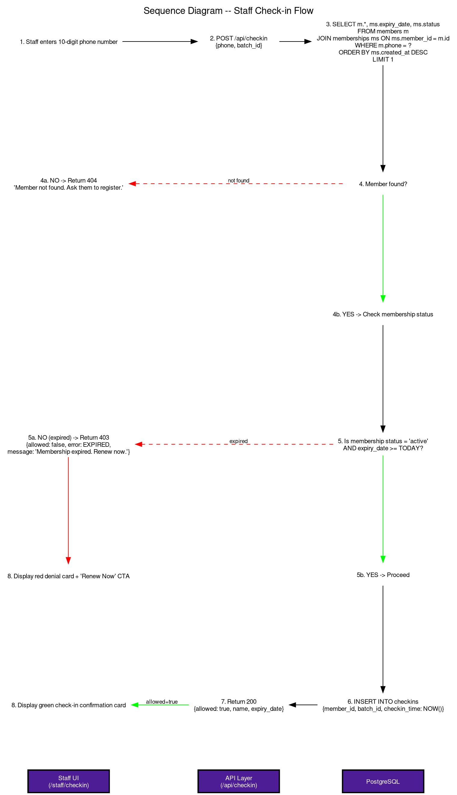

**DOT Source:** `docs/diagrams/06_seq_checkin.dot`

---

### 7.7 Sequence Diagram — Waitlist Auto-Promotion

Shows a staff cancellation triggering the full promotion chain: cancellation, `booked_count` decrement, waitlist query for lowest unnotified position, automatic booking creation, `booked_count` increment, `notified` flag update, WhatsApp deep-link generation, and staff notification display — all within a single transaction.

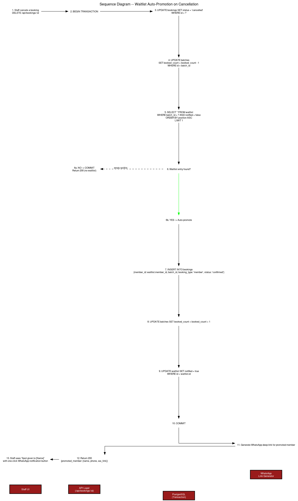

**DOT Source:** `docs/diagrams/07_seq_waitlist.dot`

---

### 7.8 Activity Diagram — Routing Engine (R1 to R6)

Shows the complete decision flow of the routing engine as an activity diagram with start/end nodes, decision diamonds, action nodes for each rule application, rule priority ordering, and the final output computation. The hard-block path for R1 terminates early at a separate end state.

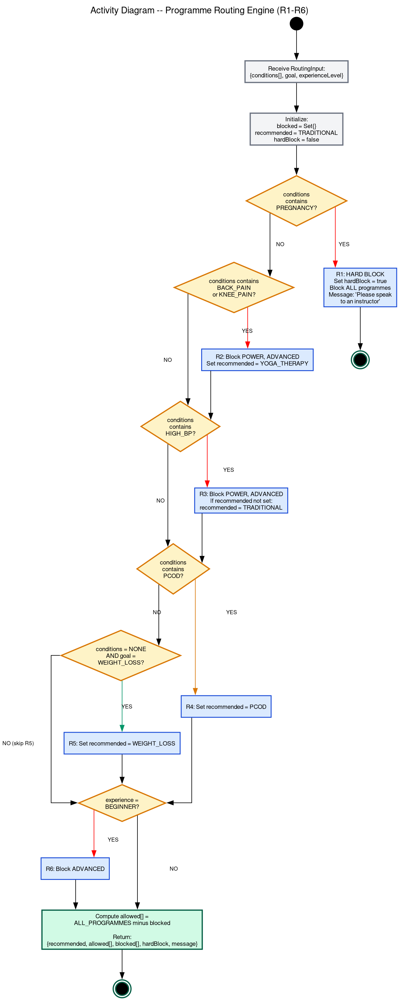

**DOT Source:** `docs/diagrams/08_activity_routing.dot`

---

### 7.9 State Machine — Membership Lifecycle

Shows all states a membership passes through: NO MEMBERSHIP, TRIAL BOOKED, ACTIVE, EXPIRING SOON, EXPIRED, CANCELLED. Transition labels include the triggering event and rule reference (B2, B4). Guard notes attached to relevant states.

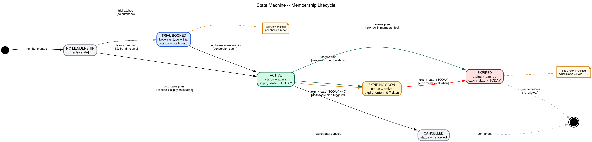

**DOT Source:** `docs/diagrams/09_state_membership.dot`

---

### 7.10 State Machine — Booking Lifecycle

Shows all booking states: BOOKING REQUESTED, VALIDATION PASSED, CONFIRMED, WAITLISTED, ATTENDED, CANCELLED, REJECTED. Transition labels reference the enforced rules (B1, B2, B4) and the waitlist auto-promotion transition back to CONFIRMED.

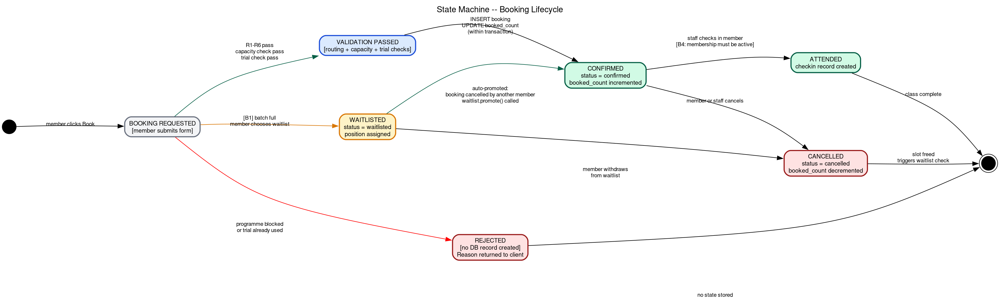

**DOT Source:** `docs/diagrams/10_state_booking.dot`

---

### 7.11 Component Diagram

Shows the full MVP component architecture across four layers: Frontend (Next.js pages, React Hook Form, Zustand, React Query, Supabase Realtime), API Layer (6 route handlers), Service and Business Logic Layer (Routing Engine, WhatsApp Service, Zod Schemas, 4 Repository classes), and Data Layer (PostgreSQL, Auth, Realtime, PgBouncer, DB Views). All inter-component dependencies are shown.

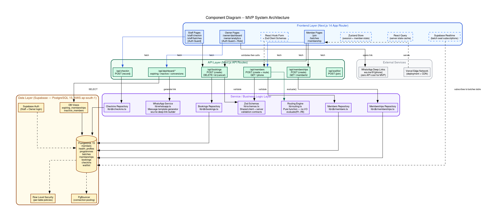

**DOT Source:** `docs/diagrams/11_component.dot`

---

### 7.12 Deployment Diagram

Shows physical deployment topology: client devices, Vercel Edge CDN and Serverless Functions, Supabase platform components (PostgreSQL 15, Auth, Realtime, PgBouncer, Storage), and the dashed future layer (Redis, BullMQ, Read Replica, WhatsApp Business API, Multi-Tenant layer). The `tenant_id` column bridge between MVP and future is annotated.

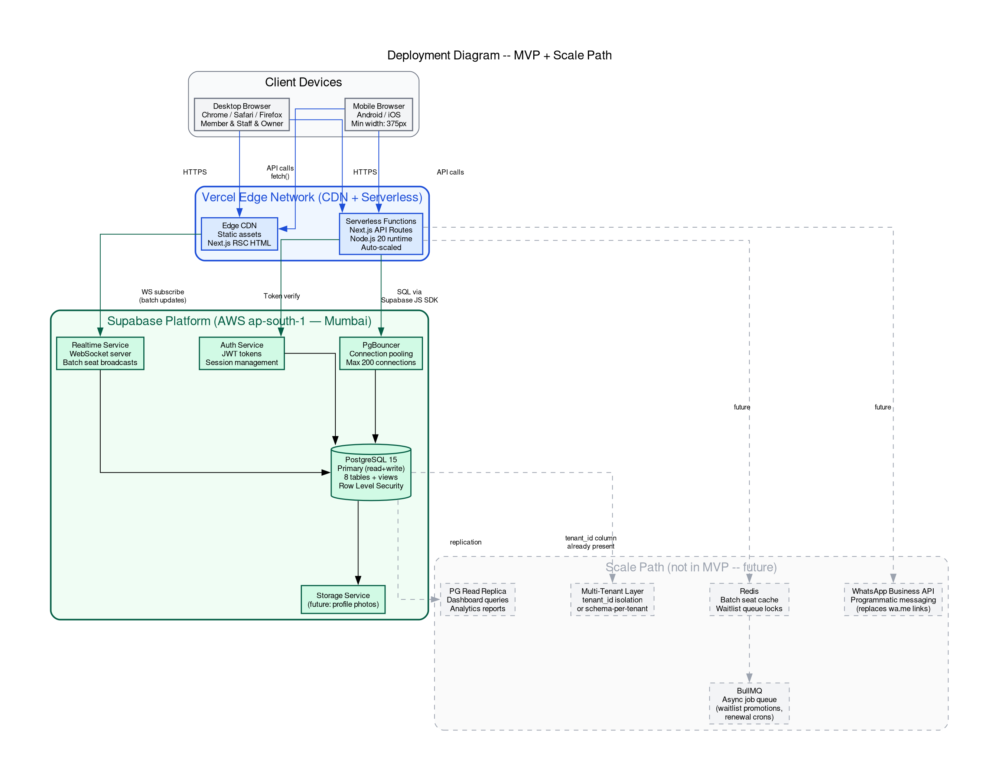

**DOT Source:** `docs/diagrams/12_deployment.dot`

---


---

### 7.14 Crisis Adaptation Architecture

Shows the end-to-end crisis adaptation architecture countering commodity AI apps via multi-signal retention risk scoring, tailored WhatsApp recovery engines, and safe human-led programme explainers.

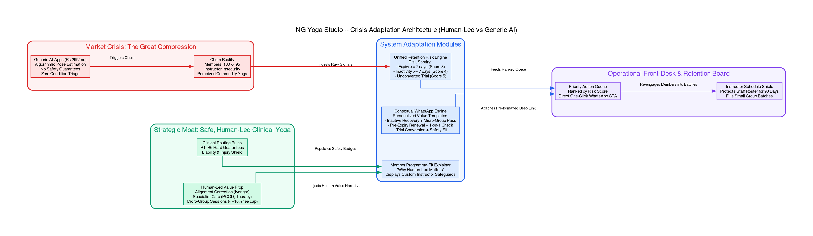

**DOT Source:** 

### 7.13 Scalability Architecture — Phase Progression

Shows the three scaling phases side by side (Phase 1: single studio MVP, Phase 2: multi-branch with NestJS and Redis, Phase 3: SaaS with microservices, mobile apps, and ML) with transition arrows labeled with the specific architectural change required at each step.

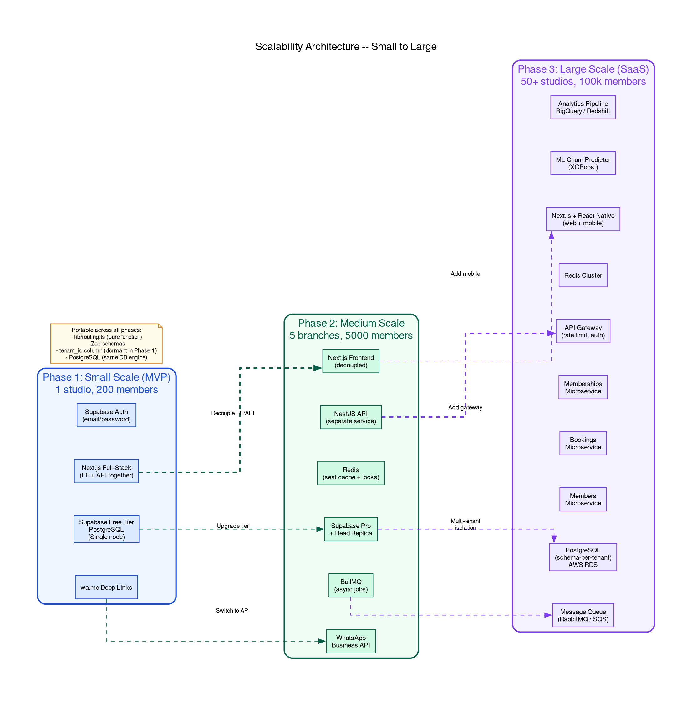

**DOT Source:** `docs/diagrams/13_scalability.dot`

---

## 8. Tech Stack

### 8.1 Technology Selection Table

| Layer | Technology | Version | Rationale | Scale Path |
|-------|-----------|---------|-----------|------------|
| Language | TypeScript | 5.x, strict mode | Type safety catches routing logic bugs at compile time; shared types between client and server | Unchanged at all scales |
| Frontend Framework | Next.js | 14 (App Router) | Server Components reduce JS bundle; API Routes eliminate separate backend in Phase 1; file-based routing | Decouple frontend and extract API to NestJS in Phase 2 |
| Styling | Tailwind CSS | 3.x | Utility-first; no custom CSS maintenance; consistent design tokens | Unchanged |
| UI Components | shadcn/ui (Radix UI) | Latest | Accessible, unstyled primitives; full ownership of component code; no library fighting | Unchanged |
| Icons | Lucide React | Latest | Tree-shakable; consistent stroke-width icon set | Unchanged |
| Form Management | React Hook Form | 7.x | Uncontrolled inputs for performance; native TypeScript support; integrates with Zod | Unchanged |
| Validation | Zod | 3.x | Single schema runs on client and server; no duplication; parse-not-validate philosophy | Unchanged; schemas are the API contract |
| Client State | Zustand | 4.x | Minimal boilerplate; sufficient for booking flow session state | Replace with Redux Toolkit if state complexity grows beyond 5 stores |
| Server State | TanStack Query | 5.x | Intelligent caching, background refetch, stale-while-revalidate for batch data | Unchanged |
| Database | PostgreSQL 15 via Supabase | 15.x | ACID compliance; row-level locks for concurrency; array columns for health conditions; JSONB available for future extensibility | Migrate to AWS RDS Multi-AZ or self-hosted PG cluster in Phase 3 |
| Auth | Supabase Auth | Built-in | JWT-based; email/password for staff; RLS policy enforcement | Replace with Auth0 or Keycloak for enterprise SSO in Phase 3 |
| Real-time | Supabase Realtime | Built-in | WebSocket-based change data capture from PostgreSQL; zero configuration | Replace with Redis Pub/Sub and dedicated WebSocket server in Phase 2 |
| Database Client | Supabase JS SDK | 2.x | Typed queries generated from schema; built-in RLS integration | Repository pattern means only `lib/db/` files change if SDK is swapped |
| Deployment | Vercel | — | Zero-config CI/CD from GitHub; edge network; automatic preview deployments | Migrate to Kubernetes on AWS EKS in Phase 3 |
| Package Manager | pnpm | 8.x | Faster installs; strict dependency resolution; disk efficient with symlinks | Unchanged |

### 8.2 Development Toolchain

| Tool | Purpose |
|------|---------|
| ESLint | Static analysis and code quality |
| Prettier | Deterministic code formatting |
| Husky + lint-staged | Pre-commit hook: lint and format only staged files |
| Supabase CLI | Local database development and migration management |
| Vercel CLI | Deployment management and environment variable sync |

---

## 9. System Architecture

### 9.1 Layered Architecture

The system follows a strict four-layer architecture. Each layer communicates only with the layer directly below it.

```
Layer 1: Presentation
  Next.js React pages and components.
  Responsible for rendering, user interaction, form handling.
  No business logic. No direct database calls.

Layer 2: API (Transport)
  Next.js API Routes (/api/**).
  Responsible for HTTP request parsing, auth validation,
  Zod server-side validation, orchestrating service calls,
  and returning typed HTTP responses.
  No SQL. No rendering.

Layer 3: Service / Business Logic
  lib/routing.ts: Pure routing engine.
  lib/whatsapp.ts: Message template builder.
  lib/schemas.ts: Zod schema definitions.
  Responsible for all domain rules and calculations.
  No HTTP context. No direct database calls.

Layer 4: Data / Repository
  lib/db/members.ts, bookings.ts, memberships.ts, checkins.ts.
  Responsible for all SQL and database calls.
  No business logic. No HTTP context.
```

This separation means:
- The routing engine can be unit tested with zero mocking.
- The database can be swapped by rewriting only `lib/db/`.
- The API can be extracted to a separate service by moving `app/api/` to a NestJS controller without touching the service or repository layers.

### 9.2 Concurrency Safety Design

Batch booking is a concurrent write problem. Two members can simultaneously attempt to book the last seat in a batch. The system solves this at the database layer:

```
BEGIN TRANSACTION
  SELECT booked_count FROM batches WHERE id = $1 FOR UPDATE;
  -- FOR UPDATE acquires a row-level exclusive lock.
  -- All other transactions attempting to lock the same row block here.
  IF booked_count >= capacity THEN
    ROLLBACK; RETURN 409;
  END IF;
  INSERT INTO bookings (...);
  UPDATE batches SET booked_count = booked_count + 1 WHERE id = $1;
COMMIT;
```

The `FOR UPDATE` lock ensures only one transaction can modify the batch row at a time. The second concurrent request will wait for the lock, then re-read an updated `booked_count`, and correctly see the batch as full.

### 9.3 Project Directory Structure

```
ng-yoga/
├── app/
│   ├── (public)/
│   │   ├── page.tsx
│   │   ├── join/
│   │   │   ├── page.tsx
│   │   │   └── recommendation/page.tsx
│   │   ├── batches/page.tsx
│   │   └── membership/page.tsx
│   ├── (staff)/
│   │   ├── layout.tsx          -- auth guard
│   │   ├── checkin/page.tsx
│   │   └── batches/page.tsx
│   ├── (owner)/
│   │   ├── layout.tsx          -- auth guard + role check
│   │   ├── dashboard/page.tsx
│   │   └── analytics/page.tsx
│   └── api/
│       ├── members/route.ts
│       ├── bookings/
│       │   ├── route.ts
│       │   └── [id]/route.ts
│       ├── memberships/route.ts
│       ├── checkin/route.ts
│       ├── dashboard/
│       │   ├── expiring/route.ts
│       │   ├── inactive/route.ts
│       │   └── conversions/route.ts
│       └── waitlist/route.ts
├── components/
│   ├── forms/
│   │   ├── HealthIntakeForm.tsx
│   │   └── CheckinForm.tsx
│   ├── cards/
│   │   ├── ProgrammeCard.tsx
│   │   ├── BatchCard.tsx
│   │   ├── MembershipCard.tsx
│   │   └── MemberCard.tsx
│   ├── dashboard/
│   │   ├── ExpiringTable.tsx
│   │   ├── InactiveTable.tsx
│   │   └── ConversionStats.tsx
│   └── ui/                     -- shadcn generated components
├── lib/
│   ├── supabase.ts             -- singleton client
│   ├── routing.ts              -- pure routing engine (R1-R6)
│   ├── schemas.ts              -- all Zod schemas
│   ├── whatsapp.ts             -- message template generator
│   └── db/
│       ├── members.ts
│       ├── bookings.ts
│       ├── memberships.ts
│       └── checkins.ts
├── types/
│   └── index.ts                -- all shared TypeScript interfaces
├── supabase/
│   └── migrations/
│       ├── 001_initial_schema.sql
│       └── 002_seed_programmes.sql
└── public/
```

---

## 10. Database Schema

### 10.1 Complete SQL Schema

```sql
CREATE EXTENSION IF NOT EXISTS "uuid-ossp";

-- ============================================================
-- members
-- tenant_id present but unused in Phase 1 (scale hook)
-- ============================================================
CREATE TABLE members (
  id               UUID        PRIMARY KEY DEFAULT uuid_generate_v4(),
  tenant_id        UUID        DEFAULT NULL,                          -- Phase 2 scale hook
  name             TEXT        NOT NULL CHECK (char_length(name) >= 2),
  phone            CHAR(10)    NOT NULL,
  age              INT         NOT NULL CHECK (age BETWEEN 10 AND 80),
  experience_level TEXT        NOT NULL
    CHECK (experience_level IN ('beginner', 'intermediate', 'advanced')),
  created_at       TIMESTAMPTZ NOT NULL DEFAULT NOW(),
  updated_at       TIMESTAMPTZ NOT NULL DEFAULT NOW(),
  CONSTRAINT members_phone_tenant_unique UNIQUE (phone, tenant_id)
  -- In Phase 1 tenant_id is NULL for all rows, so phone is effectively globally unique.
  -- In Phase 2, add NOT NULL to tenant_id; the constraint then scopes uniqueness per tenant.
);

CREATE INDEX idx_members_phone ON members (phone);

-- ============================================================
-- health_profiles
-- Separated from members: extensible, easier to audit-log separately
-- ============================================================
CREATE TABLE health_profiles (
  id          UUID        PRIMARY KEY DEFAULT uuid_generate_v4(),
  member_id   UUID        NOT NULL REFERENCES members (id) ON DELETE CASCADE,
  conditions  TEXT[]      NOT NULL DEFAULT '{}',
  main_goal   TEXT        NOT NULL
    CHECK (main_goal IN ('weight_loss', 'flexibility', 'stress_relief', 'fitness')),
  consent_given BOOLEAN   NOT NULL DEFAULT FALSE,
  created_at  TIMESTAMPTZ NOT NULL DEFAULT NOW(),
  updated_at  TIMESTAMPTZ NOT NULL DEFAULT NOW(),
  UNIQUE (member_id)
);

-- ============================================================
-- programmes
-- Seeded once; referenced by batches
-- ============================================================
CREATE TABLE programmes (
  id          UUID    PRIMARY KEY DEFAULT uuid_generate_v4(),
  name        TEXT    NOT NULL UNIQUE,
  type        TEXT    NOT NULL
    CHECK (type IN ('Traditional', 'Advanced', 'Iyengar', 'Power',
                    'Weight Loss', 'PCOD', 'Yoga Therapy')),
  description TEXT,
  is_active   BOOLEAN NOT NULL DEFAULT TRUE
);

-- ============================================================
-- batches
-- tenant_id present as scale hook
-- Constraint: booked_count can never exceed capacity at DB level
-- ============================================================
CREATE TABLE batches (
  id           UUID        PRIMARY KEY DEFAULT uuid_generate_v4(),
  programme_id UUID        NOT NULL REFERENCES programmes (id),
  tenant_id    UUID        DEFAULT NULL,                             -- Phase 2 scale hook
  time_slot    TEXT        NOT NULL CHECK (time_slot IN ('morning', 'evening')),
  batch_date   DATE        NOT NULL,
  capacity     INT         NOT NULL DEFAULT 15 CHECK (capacity > 0),
  booked_count INT         NOT NULL DEFAULT 0 CHECK (booked_count >= 0),
  instructor   TEXT,
  is_active    BOOLEAN     NOT NULL DEFAULT TRUE,
  created_at   TIMESTAMPTZ NOT NULL DEFAULT NOW(),
  CONSTRAINT no_overbooking CHECK (booked_count <= capacity)
);

CREATE INDEX idx_batches_date      ON batches (batch_date);
CREATE INDEX idx_batches_programme ON batches (programme_id);
CREATE INDEX idx_batches_tenant    ON batches (tenant_id);           -- prepared for Phase 2

-- ============================================================
-- memberships
-- One member can have multiple membership rows (renewal history).
-- The active membership is the most recent row with status = 'active'.
-- ============================================================
CREATE TABLE memberships (
  id          UUID        PRIMARY KEY DEFAULT uuid_generate_v4(),
  member_id   UUID        NOT NULL REFERENCES members (id) ON DELETE CASCADE,
  plan_type   TEXT        NOT NULL
    CHECK (plan_type IN ('1month', '3months', '6months')),
  price       INT         NOT NULL CHECK (price IN (1500, 4000, 7500)),
  start_date  DATE        NOT NULL DEFAULT CURRENT_DATE,
  expiry_date DATE        NOT NULL,
  status      TEXT        NOT NULL DEFAULT 'active'
    CHECK (status IN ('active', 'expired', 'cancelled')),
  created_at  TIMESTAMPTZ NOT NULL DEFAULT NOW(),
  CONSTRAINT valid_expiry CHECK (expiry_date > start_date)
);

CREATE INDEX idx_memberships_member ON memberships (member_id);
CREATE INDEX idx_memberships_expiry ON memberships (expiry_date);
CREATE INDEX idx_memberships_status ON memberships (status);

-- ============================================================
-- bookings
-- booking_type distinguishes free trial from paid member bookings.
-- UNIQUE on (member_id, batch_id) prevents double-booking same batch.
-- ============================================================
CREATE TABLE bookings (
  id           UUID        PRIMARY KEY DEFAULT uuid_generate_v4(),
  member_id    UUID        NOT NULL REFERENCES members (id) ON DELETE CASCADE,
  batch_id     UUID        NOT NULL REFERENCES batches (id) ON DELETE CASCADE,
  booking_type TEXT        NOT NULL CHECK (booking_type IN ('trial', 'member')),
  status       TEXT        NOT NULL DEFAULT 'confirmed'
    CHECK (status IN ('confirmed', 'cancelled', 'waitlisted')),
  created_at   TIMESTAMPTZ NOT NULL DEFAULT NOW(),
  UNIQUE (member_id, batch_id)
);

CREATE INDEX idx_bookings_member ON bookings (member_id);
CREATE INDEX idx_bookings_batch  ON bookings (batch_id);
CREATE INDEX idx_bookings_type   ON bookings (booking_type);

-- ============================================================
-- checkins
-- One row per attendance event. No unique constraint — member can
-- check in to multiple different batches on the same day.
-- ============================================================
CREATE TABLE checkins (
  id           UUID        PRIMARY KEY DEFAULT uuid_generate_v4(),
  member_id    UUID        NOT NULL REFERENCES members (id) ON DELETE CASCADE,
  batch_id     UUID        NOT NULL REFERENCES batches (id) ON DELETE CASCADE,
  checkin_time TIMESTAMPTZ NOT NULL DEFAULT NOW()
);

CREATE INDEX idx_checkins_member ON checkins (member_id);
CREATE INDEX idx_checkins_time   ON checkins (checkin_time DESC);

-- ============================================================
-- waitlist
-- position is assigned manually from application layer to allow
-- reordering. UNIQUE on (member_id, batch_id) prevents duplicate entries.
-- ============================================================
CREATE TABLE waitlist (
  id         UUID        PRIMARY KEY DEFAULT uuid_generate_v4(),
  member_id  UUID        NOT NULL REFERENCES members (id) ON DELETE CASCADE,
  batch_id   UUID        NOT NULL REFERENCES batches (id) ON DELETE CASCADE,
  position   INT         NOT NULL,
  notified   BOOLEAN     NOT NULL DEFAULT FALSE,
  created_at TIMESTAMPTZ NOT NULL DEFAULT NOW(),
  UNIQUE (member_id, batch_id)
);

CREATE INDEX idx_waitlist_batch    ON waitlist (batch_id, position);
CREATE INDEX idx_waitlist_notified ON waitlist (notified) WHERE notified = FALSE;

-- ============================================================
-- tenants (Phase 2 — not created in Phase 1 migration)
-- Present here for documentation; created in migration 003.
-- ============================================================
-- CREATE TABLE tenants (
--   id         UUID        PRIMARY KEY DEFAULT uuid_generate_v4(),
--   name       TEXT        NOT NULL,
--   city       TEXT,
--   plan_tier  TEXT        CHECK (plan_tier IN ('starter', 'professional', 'enterprise')),
--   created_at TIMESTAMPTZ NOT NULL DEFAULT NOW()
-- );

-- ============================================================
-- Convenience Views
-- ============================================================

CREATE VIEW expiring_memberships AS
SELECT
  m.id          AS member_id,
  m.name,
  m.phone,
  ms.plan_type,
  ms.expiry_date,
  (ms.expiry_date - CURRENT_DATE) AS days_remaining
FROM   members m
JOIN   memberships ms ON ms.member_id = m.id
WHERE  ms.status = 'active'
  AND  ms.expiry_date BETWEEN CURRENT_DATE AND (CURRENT_DATE + INTERVAL '7 days')
ORDER  BY ms.expiry_date ASC;

CREATE VIEW inactive_members AS
SELECT
  m.id          AS member_id,
  m.name,
  m.phone,
  ms.plan_type,
  ms.expiry_date,
  MAX(c.checkin_time)                                          AS last_checkin,
  EXTRACT(DAY FROM NOW() - MAX(c.checkin_time))::INT          AS days_inactive
FROM   members m
JOIN   memberships ms ON ms.member_id = m.id AND ms.status = 'active'
LEFT   JOIN checkins c ON c.member_id = m.id
GROUP  BY m.id, m.name, m.phone, ms.plan_type, ms.expiry_date
HAVING MAX(c.checkin_time) IS NULL
    OR MAX(c.checkin_time) < (NOW() - INTERVAL '7 days')
ORDER  BY last_checkin ASC NULLS FIRST;
```

### 10.2 Index Strategy Rationale

| Index | Purpose |
|-------|---------|
| `members.phone` | Check-in lookup; free trial uniqueness check |
| `batches.batch_date` | Filter batches by date on booking page |
| `batches.tenant_id` | Prepared for Phase 2 multi-tenant queries |
| `memberships.expiry_date` | Expiring members dashboard query |
| `memberships.status` | Filter active memberships for check-in and dashboard |
| `checkins.checkin_time DESC` | Recent check-in lookup; inactive member detection |
| `waitlist.(batch_id, position)` | Efficient first-in-queue lookup for promotion |
| `waitlist.notified (partial)` | Only indexes `FALSE` rows; reduces index size as waitlist is promoted |

---

## 11. API Specification

### 11.1 Route Table

| Method | Route | Auth | Description |
|--------|-------|------|-------------|
| POST | `/api/members` | None | Create or update member and health profile; return routing result |
| GET | `/api/members/:phone` | Staff | Look up member by phone for check-in or staff view |
| GET | `/api/batches` | None | List batches with real-time seat counts; supports `?date=` and `?programme=` filters |
| POST | `/api/bookings` | None | Create a booking with full rule enforcement |
| DELETE | `/api/bookings/:id` | Staff | Cancel a booking; trigger waitlist promotion |
| POST | `/api/memberships` | None | Create a membership from a plan selection |
| GET | `/api/memberships/:memberId` | Staff | Get the active membership for a member |
| POST | `/api/checkin` | Staff | Record a check-in after expiry validation |
| GET | `/api/dashboard/expiring` | Owner | Members expiring in the next 7 days |
| GET | `/api/dashboard/inactive` | Owner | Active members with no check-in for 7 or more days |
| GET | `/api/dashboard/conversions` | Owner | Trial and conversion counts and rate |
| POST | `/api/waitlist` | None | Join the waitlist for a full batch |

### 11.2 Representative Request and Response Examples

**POST /api/members — Success**

```json
// Request body
{
  "name": "Anjali Verma",
  "phone": "9876543210",
  "age": 32,
  "experience_level": "beginner",
  "main_goal": "weight_loss",
  "conditions": ["pcod"],
  "consent_given": true
}

// Response 201
{
  "member_id": "4a3f2b1c-...",
  "routing": {
    "recommended": "PCOD",
    "allowed": ["Traditional", "Iyengar", "PCOD", "Weight Loss", "Yoga Therapy"],
    "blocked": ["Advanced", "Power"],
    "block_reasons": {
      "Advanced": "R6: Beginners cannot join Advanced.",
      "Power": "R2: Not recommended for PCOD without medical clearance."
    },
    "hard_block": false,
    "message": "We recommend the PCOD programme for you."
  }
}
```

**POST /api/bookings — Batch Full**

```json
// Request
{ "member_id": "4a3f2b1c-...", "batch_id": "b7c2...", "booking_type": "trial" }

// Response 409
{
  "error": "BATCH_FULL",
  "message": "This batch is full. You can join the waitlist.",
  "waitlist_available": true
}
```

**POST /api/checkin — Expired Membership**

```json
// Request
{ "phone": "9876543210", "batch_id": "b7c2..." }

// Response 403
{
  "allowed": false,
  "error": "MEMBERSHIP_EXPIRED",
  "member_name": "Anjali Verma",
  "expiry_date": "2026-10-15",
  "message": "Membership expired. Please renew to continue."
}
```

---

## 12. Application Layer Design

### 12.1 Routing Engine Implementation

The routing engine is a pure TypeScript function. It takes a typed input and returns a typed result. It imports nothing from Next.js, Supabase, or any other framework. This makes it runnable on any JavaScript runtime without modification.

```typescript
// lib/routing.ts

export type Condition      = 'back_pain' | 'knee_pain' | 'high_bp' | 'pcod' | 'pregnancy' | 'none'
export type Goal           = 'weight_loss' | 'flexibility' | 'stress_relief' | 'fitness'
export type ExperienceLevel = 'beginner' | 'intermediate' | 'advanced'
export type ProgrammeType  = 'Traditional' | 'Advanced' | 'Iyengar' | 'Power'
                           | 'Weight Loss' | 'PCOD' | 'Yoga Therapy'

export interface RoutingInput {
  conditions:       Condition[]
  goal:             Goal
  experienceLevel:  ExperienceLevel
}

export interface RoutingResult {
  recommended:  ProgrammeType
  allowed:      ProgrammeType[]
  blocked:      ProgrammeType[]
  blockReasons: Record<ProgrammeType, string>
  hardBlock:    boolean
  message:      string
}

const ALL_PROGRAMMES: ProgrammeType[] = [
  'Traditional', 'Advanced', 'Iyengar', 'Power',
  'Weight Loss', 'PCOD', 'Yoga Therapy'
]

export function routeMember(input: RoutingInput): RoutingResult {
  const { conditions, goal, experienceLevel } = input
  const blocked      = new Set<ProgrammeType>()
  const blockReasons: Partial<Record<ProgrammeType, string>> = {}

  const block = (p: ProgrammeType, reason: string) => {
    blocked.add(p)
    blockReasons[p] = reason
  }

  // R1 — Pregnancy: hard block, exits immediately
  if (conditions.includes('pregnancy')) {
    return {
      recommended:  'Yoga Therapy',
      allowed:      [],
      blocked:      [...ALL_PROGRAMMES],
      blockReasons: Object.fromEntries(ALL_PROGRAMMES.map(p => [p, 'R1: Consult instructor before joining.'])) as Record<ProgrammeType, string>,
      hardBlock:    true,
      message:      'Please speak to an instructor before joining.'
    }
  }

  let recommended: ProgrammeType = 'Traditional'

  // R2 — Back pain or knee pain
  if (conditions.includes('back_pain') || conditions.includes('knee_pain')) {
    block('Power',    'R2: Not safe with back or knee pain.')
    block('Advanced', 'R2: Not safe with back or knee pain.')
    recommended = 'Yoga Therapy'
  }

  // R3 — High BP
  if (conditions.includes('high_bp')) {
    block('Power',    'R3: Not safe with high blood pressure.')
    block('Advanced', 'R3: Not safe with high blood pressure.')
    if (recommended !== 'Yoga Therapy') recommended = 'Traditional'
  }

  // R4 — PCOD (overrides R5)
  if (conditions.includes('pcod')) {
    recommended = 'PCOD'
  }

  // R5 — No condition, weight-loss goal
  if (conditions.includes('none') && goal === 'weight_loss' && !conditions.includes('pcod')) {
    recommended = 'Weight Loss'
  }

  // R6 — Beginner: always applied
  if (experienceLevel === 'beginner') {
    block('Advanced', 'R6: Advanced is not open to beginners.')
  }

  const allowed = ALL_PROGRAMMES.filter(p => !blocked.has(p))

  return {
    recommended,
    allowed,
    blocked: [...blocked],
    blockReasons: blockReasons as Record<ProgrammeType, string>,
    hardBlock: false,
    message:  `We recommend the ${recommended} programme for you.`
  }
}
```

### 12.2 Repository Pattern

Each domain entity has a dedicated repository file. Example for bookings:

```typescript
// lib/db/bookings.ts

import { supabase } from '@/lib/supabase'
import type { Booking } from '@/types'

export const bookingsRepo = {

  async create(data: {
    member_id:    string
    batch_id:     string
    booking_type: 'trial' | 'member'
  }): Promise<Booking> {
    const { data: booking, error } = await supabase
      .from('bookings')
      .insert(data)
      .select()
      .single()
    if (error) throw error
    return booking
  },

  async hasUsedTrial(memberId: string): Promise<boolean> {
    const { count } = await supabase
      .from('bookings')
      .select('id', { count: 'exact', head: true })
      .eq('member_id', memberId)
      .eq('booking_type', 'trial')
    return (count ?? 0) > 0
  },

  async cancel(bookingId: string): Promise<void> {
    const { error } = await supabase
      .from('bookings')
      .update({ status: 'cancelled' })
      .eq('id', bookingId)
    if (error) throw error
  },

  async getFirstWaitlistEntry(batchId: string) {
    const { data } = await supabase
      .from('waitlist')
      .select('*, members(name, phone)')
      .eq('batch_id', batchId)
      .eq('notified', false)
      .order('position', { ascending: true })
      .limit(1)
      .single()
    return data
  }
}
```

---

## 13. Scalability Strategy

### 13.1 Phase 1 to Phase 2: Multi-Branch

Required changes when expanding to multiple studio locations in the same city:

| Component | Change Required |
|-----------|----------------|
| Database | Add `NOT NULL` to `tenant_id` on `members` and `batches`. Create `tenants` table (migration 003). Add FK constraint. |
| Auth | Add `tenant_id` to Supabase Auth user metadata. Staff see only their branch. |
| API | Add `tenant_id` filter to all repository queries. Derive `tenant_id` from the authenticated user's session. |
| Frontend | Add branch selector for owner dashboard. Staff are scoped to one branch automatically. |
| Routing Engine | No change. Already stateless and tenant-agnostic. |
| Deployment | No change. Vercel scales serverless functions automatically. |

**Effort estimate:** 2 to 3 days for a two-person team.

### 13.2 Phase 2 to Phase 3: SaaS and Franchise

Required changes when operating as a multi-city SaaS product with 50 or more studios:

| Concern | Solution |
|---------|----------|
| API throughput | Extract Next.js API Routes into a dedicated NestJS service. Deploy as Docker containers on Kubernetes. |
| Batch booking race conditions at high concurrency | Add Redis-based distributed lock in front of the database transaction. Use Redlock algorithm. |
| Async job processing | Replace in-request waitlist promotion with BullMQ job queue backed by Redis. |
| Database read load | Add PostgreSQL read replica. Route dashboard and analytics queries to the replica. |
| Real-time scaling | Replace Supabase Realtime with a dedicated WebSocket server backed by Redis Pub/Sub. |
| WhatsApp messaging | Integrate WhatsApp Business API to send messages programmatically instead of generating deep links. |
| Mobile | Add React Native application. Business logic in `lib/routing.ts` and `lib/schemas.ts` is already framework-free and can be imported directly. |
| Tenant isolation | Evaluate schema-per-tenant (stronger isolation, harder to query across) vs row-level tenant_id (easier cross-tenant analytics, simpler operations). Recommend row-level for under 500 tenants. |
| Churn prediction | Build an XGBoost model trained on check-in frequency, plan type, and historical renewal behaviour. Feed predictions to the retention dashboard. |
| Analytics | Set up an event streaming pipeline: application emits domain events to a message queue; a consumer writes to BigQuery or Redshift for BI reporting. |

### 13.3 Capacity Estimates

| Metric | Phase 1 | Phase 2 | Phase 3 |
|--------|---------|---------|---------|
| Studios | 1 | 5 | 50 |
| Members | 200 | 5,000 | 100,000 |
| Bookings per day | 50 | 500 | 5,000 |
| Check-ins per day | 50 | 500 | 5,000 |
| Concurrent users (peak) | 5 | 50 | 500 |
| Database size | Under 10 MB | Under 500 MB | Under 10 GB |
| Infrastructure | Supabase Free, Vercel Hobby | Supabase Pro + Read Replica, Vercel Pro | AWS RDS Multi-AZ, EKS, Redis Cluster |

PostgreSQL handles all three phases comfortably. The application layer is the scaling constraint, not the database.

---

## 14. Implementation Plan

### 14.1 Phase 0 — Project Setup (30 minutes)

```
pnpm create next-app@latest ng-yoga --typescript --tailwind --app --src-dir=false
cd ng-yoga
pnpm dlx shadcn@latest init
pnpm add @supabase/supabase-js react-hook-form zod @hookform/resolvers
pnpm add zustand @tanstack/react-query lucide-react
pnpm add -D @types/node eslint prettier
```

- Create Supabase project in ap-south-1 region.
- Run migration `001_initial_schema.sql`.
- Run migration `002_seed_programmes.sql`.
- Configure `.env.local` with `NEXT_PUBLIC_SUPABASE_URL` and `NEXT_PUBLIC_SUPABASE_ANON_KEY`.
- Create Vercel project linked to GitHub repository.

### 14.2 Phase 1 — Data and Logic Layer (45 minutes)

- Implement `lib/supabase.ts` singleton client.
- Implement `lib/routing.ts` with all R1 to R6 rules and unit test each rule.
- Implement `lib/schemas.ts` with Zod schemas for all request bodies.
- Implement `lib/whatsapp.ts` message template builder.
- Implement `lib/db/members.ts`, `bookings.ts`, `memberships.ts`, `checkins.ts`.
- Define all shared TypeScript types in `types/index.ts`.

### 14.3 Phase 2 — Level 1 Features (2 hours)

- Health intake form with client-side validation and conditional field display.
- Routing recommendation page with programme cards.
- Batch listing with Supabase Realtime subscription for seat counts.
- Booking flow with full server-side rule enforcement.
- Membership plan selection and confirmation card.
- Staff check-in screen with phone search and approval or denial flow.
- Apply medical disclaimer to all health-related pages.

### 14.4 Phase 3 — Level 2 Features (1 hour)

- Expiring memberships table using the `expiring_memberships` view.
- Inactive members table using the `inactive_members` view.
- WhatsApp deep-link button generation for both lists.
- Trial conversion report from aggregation queries.

### 14.5 Phase 4 — Level 3 and Final Polish (30 minutes)

- Waitlist join endpoint and UI.
- Automatic waitlist promotion on booking cancellation.
- Loading states and skeleton screens.
- Error boundaries on all async sections.
- Mobile viewport testing at 375 px.
- Final deployment to Vercel and live URL verification.

---

## 15. Legal and Ethical Constraints

| Requirement | Implementation |
|-------------|---------------|
| No medical advice | Disclaimer rendered on every page that collects or displays health conditions: "This is not medical advice. Consult a qualified health professional for medical concerns." |
| No real health data | System uses only self-created sample data. No real member or patient information used at any stage. |
| Pregnancy hard block (R1) | System prevents booking entirely and directs member to speak with an instructor. The system does not offer any alternative or workaround. |
| Informed consent | Health intake form requires a checked consent checkbox before submission: "I agree to share this information with NG Yoga Studio staff for class placement purposes." Submission is blocked if unchecked. |
| Programme guidance only | The routing engine output is framed as a recommendation for class suitability, not a health assessment or diagnosis. |
| Data access restriction | Staff can view conditions relevant to check-in. Raw health profile data is not surfaced in staff-facing booking views beyond what is necessary for safety enforcement. |

---

## 16. Glossary

| Term | Definition |
|------|------------|
| SRS | Software Requirements Specification |
| R1 to R6 | Programme routing rules defined in the problem brief |
| B1 to B4 | Booking and membership enforcement rules defined in the problem brief |
| RLS | Row Level Security — PostgreSQL and Supabase security feature for per-row access policies |
| PCOD | Polycystic Ovarian Disease |
| PCOS | Polycystic Ovarian Syndrome |
| RSC | React Server Component — Next.js component that renders on the server with no client JavaScript |
| API Route | A server-side function in Next.js that handles HTTP requests, analogous to an Express route handler |
| Repository Pattern | A design pattern that abstracts database access behind a typed interface, decoupling business logic from the persistence layer |
| Zod | A TypeScript-first schema validation library that parses untrusted input at runtime |
| Supabase Realtime | A WebSocket-based service that streams database change events to connected browser clients |
| PgBouncer | A lightweight PostgreSQL connection pooler that reduces the number of open database connections |
| BullMQ | A Redis-backed job queue library for Node.js used for reliable async task processing |
| Tenant | A distinct organisation instance in a multi-tenant SaaS system; in this system, one studio or franchise branch |
| wa.me | WhatsApp's URL scheme for opening a chat with a pre-filled message without requiring the WhatsApp Business API |
| MVP | Minimum Viable Product |
| CTA | Call to Action |
| MRR | Monthly Recurring Revenue |

---

*Document version 1.0 — prepared for NG Yoga Studio hackathon submission.*
*This system guides programme choice only and does not provide medical advice.*


---

## 17. Crisis Adaptation: Countering The Great Compression

# TechSprint Crisis Adaptation Addendum
## NG Yoga Studio: Countering "The Great Compression"
**Version:** 1.1 Crisis Addendum  
**Date:** 23 October 2026  
**Context:** Memberships dropped from 180 to 95 due to low-cost AI competitors (YogAI Pro at Rs 299/mo). Two instructors at risk.

---

## 1. Problem Diagnosis & Strategic Stance

### 1.1 The Macro & Micro Threat
- **Macro**: Discretionary spending compression combined with hyper-cheap digital alternatives.
- **Micro**: Member erosion (47% drop), instructor demoralization, existential studio revenue shock.
- **The Competitor Flaw**: Generic AI apps lack safe somatic assessment, posture tactile correction, and clinical pathology adaptation. High BP, lumbar disc herniations, and prenatal conditions are dangerous when guided by non-responsive computer vision algorithms.
- **Our Positioning**: Safe, Human-Led, Clinically-Guarded Yoga Therapy and Precision Alignment (Traditional, Iyengar, Ashtanga, PCOD recovery) that apps cannot replicate without catastrophic injury liabilities.

---

## 2. Technical Modifications & Additions

### 2.1 Unified Retention Risk Engine (Data Signals)
We integrate three signals into an actionable priority triage algorithm:

1. **Expiry Risk Signal**: `expiry_date` between `TODAY` and `TODAY + 7 days`.
2. **Inactivity Risk Signal**: No check-in records for `7+ days` among active plans.
3. **Unconverted Trial Signal**: Completed free trial booking without purchasing a membership within 3 days.

#### SQL Multi-Signal View: `retention_risk_registry`
```sql
CREATE OR REPLACE VIEW retention_risk_registry AS
WITH member_last_checkin AS (
    SELECT member_id, MAX(checkin_time) AS last_checkin
    FROM checkins
    GROUP BY member_id
),
active_memberships AS (
    SELECT member_id, plan_type, expiry_date, status
    FROM memberships
    WHERE status = 'active'
),
trial_records AS (
    SELECT member_id, created_at AS trial_date
    FROM bookings
    WHERE booking_type = 'trial'
)
SELECT 
    m.id AS member_id,
    m.name,
    m.phone,
    m.experience_level,
    hp.conditions,
    hp.main_goal,
    am.plan_type,
    am.expiry_date,
    (am.expiry_date - CURRENT_DATE) AS days_to_expiry,
    mlc.last_checkin,
    COALESCE(EXTRACT(DAY FROM NOW() - mlc.last_checkin)::INT, 999) AS days_inactive,
    CASE
        -- Signal 1: Expiring within 7 days
        WHEN am.expiry_date BETWEEN CURRENT_DATE AND (CURRENT_DATE + INTERVAL '7 days') 
            THEN 'EXPIRING_SOON'
        -- Signal 2: Active but inactive for 7+ days
        WHEN am.status = 'active' AND (mlc.last_checkin IS NULL OR mlc.last_checkin < (NOW() - INTERVAL '7 days'))
            THEN 'INACTIVE_ACTIVE_MEMBER'
        -- Signal 3: Unconverted trial
        WHEN am.member_id IS NULL AND tr.trial_date IS NOT NULL AND tr.trial_date < (NOW() - INTERVAL '3 days')
            THEN 'UNCONVERTED_TRIAL'
        ELSE 'LOW_RISK'
    END AS risk_category,
    CASE 
        WHEN am.expiry_date BETWEEN CURRENT_DATE AND (CURRENT_DATE + INTERVAL '7 days') THEN 1
        WHEN am.status = 'active' AND (mlc.last_checkin < (NOW() - INTERVAL '7 days') OR mlc.last_checkin IS NULL) THEN 2
        WHEN am.member_id IS NULL AND tr.trial_date IS NOT NULL THEN 3
        ELSE 4
    END AS triage_priority
FROM members m
LEFT JOIN health_profiles hp ON hp.member_id = m.id
LEFT JOIN active_memberships am ON am.member_id = m.id
LEFT JOIN member_last_checkin mlc ON mlc.member_id = m.id
LEFT JOIN trial_records tr ON tr.member_id = m.id
WHERE 
    (am.expiry_date BETWEEN CURRENT_DATE AND (CURRENT_DATE + INTERVAL '7 days'))
    OR (am.status = 'active' AND (mlc.last_checkin IS NULL OR mlc.last_checkin < (NOW() - INTERVAL '7 days')))
    OR (am.member_id IS NULL AND tr.trial_date IS NOT NULL)
ORDER BY triage_priority ASC, days_to_expiry ASC, days_inactive DESC;
```

---

### 2.2 Crisis-Adapted Contextual WhatsApp Generator

Different member segments receive distinct tailored communications emphasizing human care, personalized modifications, and value-add small-group sessions within the 10% regulatory pricing cap:

#### Template A: Inactive Member (Human Care & Reactivation)
```
Hi {Name}, we noticed you haven't attended class in {DaysInactive} days at NG Yoga Studio. 
Generic apps cannot adjust for posture fatigue or injury risks like your instructor can. 
Book an exclusive 15-minute instructor posture-alignment review included with your plan this week. 
Reply to claim your spot: wa.me/91XXXXXXXXXX
```

#### Template B: Pre-Expiry Renewal (Value Reinforcement & 10% Capped Loyalty Incentive)
```
Hi {Name}, your NG Yoga membership concludes on {ExpiryDate}. 
To safeguard your continuous progress with our senior instructors, renew your {PlanType} plan today at our locked studio rate of Rs {CappedRenewalPrice} (saving 10% with zero price hikes). 
Secure your batch place directly: {RenewLink}
```

#### Template C: Unconverted Trial (Safe Clinical Matching)
```
Hi {Name}, thank you for taking your trial session at NG Yoga Studio. 
Because your intake indicates {ConditionsSummary}, unsupervised digital apps pose high strain risks. 
Our senior instructor has opened a special micro-group session (maximum 6 members) for your specific needs. 
Join this week with our intro package: {JoinLink}
```

---

### 2.3 Member-Facing Programme-Fit & Safety Transparency Explainer

On `/join/recommendation`, instead of merely showing approved/blocked classes, render an explicit **Clinical Differentiation Summary**:

1. **Why Human-Led Alignment Matters**:
   - Contrast auto-generated generic video flows with hands-on anatomical corrections (essential for back pain, cervical issues, and knee rehabilitation).
2. **Instructor Safeguard Badges**:
   - Explicitly list why unsafe options were blocked (`Power` yoga blocked due to BP/Lumbar strain).
   - Display instructor credentials and specializations (Iyengar prop therapy, Ashtanga breath pacing, PCOD metabolic yoga).
3. **Micro-Group & Free Trial Options**:
   - Allow booking into an instructor-supervised small group (capped at 6 to 8 members) maintaining compliance with the price cap.

---

### 2.4 Acceptance Demo Verification Matrix

| Scenario | Member Data Input | System Reaction & Verification | Message Generation |
|----------|-------------------|--------------------------------|-------------------|
| **Test Case 1: Inactive Active Member** | Rahul M. (Active 3-Month Plan, Last check-in 11 days ago) | Appears on Triage Dashboard with Priority 2 flag (`INACTIVE_ACTIVE_MEMBER`). | Generates Template A emphasizing instructor postural check-in and session re-entry. |
| **Test Case 2: Pre-Expiry Member** | Sunita K. (1-Month Plan, Expires in 4 days) | Appears with Priority 1 flag (`EXPIRING_SOON`). | Generates Template B with renewal link and 10% protected fee guarantee. |
| **Test Case 3: Safety Guardrail (Safety Test)** | Amit P. (Beginner, High Blood Pressure + Back Pain) | Routing engine strictly blocks `Advanced` (R6 beginner rule) and blocks `Power` (R2/R3 condition rule). Forces `Yoga Therapy`. | Rejection modal prevents manual override. Disclaimer explicitly rendered. |

---

### 2.5 Strict Guardrails Adherence
1. **Zero Medical Diagnoses**: The system guides class suitability and posture assistance, displaying the medical disclaimer at all times.
2. **Zero Invasions of R1–R6 Rules**: Under no market pressure can pregnancy, spinal pain, or cardiovascular restrictions be bypassed for commercial gains.
3. **Instructor Protection**: No instructor terminations for 90 days; retention workflows route members directly to fill instructors' specialized batches.
